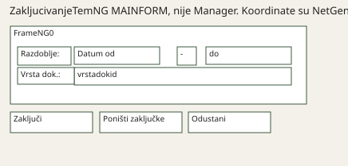

# Tipovi NetGen formi

> Napomena integracije (2026-11-13): ovaj dokument je s grane `cursor/netgen-tipovi-formi-3266`. Kod te grane (`Shell/TipForme.cs`) nije preuzet jer isto radi `Shell/OdabirForme.cs` u glavnoj liniji (R104). Dokument ostaje kao analiza za fazu C.

NetGen ima nekoliko sličnih obrazaca, ne biblioteku Carpo predložaka. Manager (stablo lijevo, master, detalj, gumbi dolje) ide samo na tip `manager`. Ostale granule zadržavaju NetGen raspored: pozicije, dock i paneli. Kontrole su DevExpress, skin je Carpo.

Izvor je svaki `PROJECT` pod `definitions/netgen`. Kopije u Agronom i BIOVEGA broje se zasebno. Lijevi panel je neprazan `TREE` ili `COMBO`. Gumb je neprazan `BUTTONS` ili `CMDnCAPTION` koji ima dvotočku.

| Tip | Broj | NetGen | Carpo |
|---|---:|---|---|
| manager | 137 | Lijevo stablo ili combo, master, detail i gumbi. | Manager: kartica Stavke, lijevi panel, gumbi dolje. |
| stablo-master | 74 | Lijevi panel i master, bez detaila. | Lijevi panel i master. Nema kartice Stavke. |
| samo-detail | 82 | Master i detail, bez lijevog panela. | Detail grid ispod mastera, bez kartice Stavke. |
| samo-grid | 143 | Samo master grid. | Samo master. Lijevi splitter je 0. Nema Stavki. |
| dijalog | 168 | ONLOAD je :forma, nema stabla ni detaila. | Forma drži NetGen koordinate. Shell ne otvara karticu Stavke. |
| ostalo | 1 | TREE i DETAILGRID bez gumba, ili sličan ostatak. | Paneli koje XML ima. Nema kartice Stavke. |

Ukupno 605 PROJECT datoteka. Manager je 137, ostali obrasci 468.

## Usporedba rasporeda

Pixel screenshot ljuske nije snimljen: ovaj stroj nema DevExpress ni prozor. Usporedba je raspored kontrola.

Dijalog koji nije Manager, `ZakljucivanjeTemNG` / `MAINFORM`, datum `datumod`: XML `LEFT=1195`. NetGen i Carpo dijele s 14 i zaokružuju bankarski na 85. Isto vrijedi za `TOP`/`WIDTH`/`HEIGHT`.

Smoke na spinu i jupiteru i dalje samo otvara SQL, uz istu zabranu procedure koja piše. Ne mjeri piksele i ne šalje `ONSUBMIT`.

Shell koji nije Manager ne dobiva karticu Stavke. `samo-grid` (`JeziciNG`) nema lijevi panel ni detail. `stablo-master` drži stablo i master. `samo-detail` drži detail grid ispod mastera, bez taba.

## manager (137)

| XML | Zastavice |
|---|---|
| `Agronom granule/AOPNovi.xml` | TREE,DETAILGRID,master-sql |
| `Agronom granule/DobUgovori.xml` | TREE,DETAILGRID |
| `Agronom granule/HRManagerGO.xml` | TREE,DETAILGRID |
| `Agronom granule/KntBlaDok.xml` | TREE,DETAILGRID,master-sql |
| `Agronom granule/KntBlaPromet.xml` | TREE,DETAILGRID,master-sql |
| `Agronom granule/KntBlaZak.xml` | TREE,DETAILGRID,master-sql |
| `Agronom granule/KntKompVerizne.xml` | TREE,DETAILGRID,master-sql |
| `Agronom granule/KOD_Doznake.xml` | TREE,DETAILGRID |
| `Agronom granule/KOD_Korekcija.xml` | TREE,DETAILGRID |
| `Agronom granule/KUPDostKN.xml` | TREE,DETAILGRID,master-sql |
| `Agronom granule/KUPNG.xml` | TREE,DETAILGRID,master-sql |
| `Agronom granule/MER_DobUgovori.xml` | TREE,DETAILGRID |
| `Agronom granule/MER_ZahtjevZaNabavkuNG.xml` | COMBO,DETAILGRID |
| `Agronom granule/MPAsortimanAzur.xml` | TREE,DETAILGRID |
| `Agronom granule/MPBlagajnaZ.xml` | TREE,DETAILGRID |
| `Agronom granule/MPDirZaduzenjeNG1DMSAgronom.xml` | TREE,DETAILGRID |
| `Agronom granule/MPDirZaduzenjeNG2DMS.xml` | TREE,DETAILGRID |
| `Agronom granule/MPDirZaduzenjeNG3DMS.xml` | TREE,DETAILGRID |
| `Agronom granule/MPIntDok.xml` | TREE,DETAILGRID |
| `Agronom granule/MPIntDokZamjenaINVENTURA.xml` | TREE,DETAILGRID,ONLOAD-forma |
| `Agronom granule/MPInventura.xml` | TREE,DETAILGRID |
| `Agronom granule/MPIzduMPZaprimi.xml` | TREE,DETAILGRID |
| `Agronom granule/MPIzdVPMPKont.xml` | TREE,DETAILGRID,master-sql |
| `Agronom granule/MPJMzaMPC.xml` | TREE,DETAILGRID |
| `Agronom granule/MPNar.xml` | TREE,DETAILGRID,master-sql |
| `Agronom granule/MPNarDobKor.xml` | TREE,DETAILGRID,master-sql |
| `Agronom granule/MPNarIzdSklAgronom.xml` | TREE,DETAILGRID |
| `Agronom granule/MPNarIzdSklKomercAgronom.xml` | TREE,DETAILGRID,master-sql |
| `Agronom granule/MPNGPregDok.xml` | TREE,DETAILGRID,ONLOAD-forma |
| `Agronom granule/MPOtpremnicaDMS.xml` | TREE,DETAILGRID |
| `Agronom granule/MPOtpremnicaDonacijaDMS.xml` | TREE,DETAILGRID |
| `Agronom granule/MPOtpremnicaKooperacijaDMS.xml` | TREE,DETAILGRID |
| `Agronom granule/MPPonuda.xml` | TREE,DETAILGRID |
| `Agronom granule/MPPovratDobDMSNG.xml` | TREE,DETAILGRID,ONLOAD-forma |
| `Agronom granule/MPPovratPDV.xml` | TREE,DETAILGRID,ONLOAD-forma |
| `Agronom granule/MPPovuVPAgronomRedovPov.xml` | TREE,DETAILGRID |
| `Agronom granule/MPPovuVPAgronomVlastPotr.xml` | TREE,DETAILGRID |
| `Agronom granule/MPPovuVPSKL.xml` | TREE,DETAILGRID |
| `Agronom granule/MPPovuVPSKLKont.xml` | TREE,DETAILGRID,master-sql |
| `Agronom granule/MPPredispIz.xml` | TREE,DETAILGRID |
| `Agronom granule/MPPredispUl.xml` | TREE,DETAILGRID |
| `Agronom granule/MPPregUtrzakNG.xml` | TREE,DETAILGRID,ONLOAD-forma |
| `Agronom granule/Narudzbe.xml` | COMBO,DETAILGRID |
| `Agronom granule/PrijemniList.xml` | COMBO,DETAILGRID |
| `Agronom granule/Statusi.xml` | TREE,DETAILGRID,master-sql |
| `Agronom granule/STIzdatnicaFarme.xml` | TREE,DETAILGRID |
| `Agronom granule/STIzlucenjeGrla.xml` | TREE,DETAILGRID,ONLOAD-forma |
| `Agronom granule/STKupovina.xml` | TREE,DETAILGRID |
| `Agronom granule/STLista.xml` | TREE,DETAILGRID,ONLOAD-forma |
| `Agronom granule/STPocetnoStanje.xml` | TREE,DETAILGRID |
| `Agronom granule/STPregDok.xml` | TREE,DETAILGRID,ONLOAD-forma |
| `Agronom granule/STPregTov.xml` | TREE,DETAILGRID,ONLOAD-forma |
| `Agronom granule/STTovUlaz.xml` | TREE,DETAILGRID,ONLOAD-forma |
| `Agronom granule/UcinakOper.xml` | TREE,DETAILGRID |
| `Agronom granule/UgovorSKupcima.xml` | TREE,DETAILGRID |
| `Agronom granule/ZahtjevZaNabavkuNG.xml` | COMBO,DETAILGRID |
| `BIOVEGA/AOPNovi.xml` | TREE,DETAILGRID,master-sql |
| `BIOVEGA/Dne_SmjeneOrg.xml` | TREE,DETAILGRID |
| `BIOVEGA/DobUgovori.xml` | TREE,DETAILGRID,master-sql |
| `BIOVEGA/HRManagerGO.xml` | TREE,DETAILGRID |
| `BIOVEGA/JOPPD.xml` | TREE,DETAILGRID |
| `BIOVEGA/KntBlaPromet.xml` | TREE,DETAILGRID,master-sql |
| `BIOVEGA/KntBlaZak.xml` | TREE,DETAILGRID,master-sql |
| `BIOVEGA/KOD_Doznake.xml` | TREE,DETAILGRID |
| `BIOVEGA/KUPDostKnNGBvg.xml` | TREE,DETAILGRID,master-sql |
| `BIOVEGA/KUPNGNGBvg.xml` | TREE,DETAILGRID,master-sql |
| `BIOVEGA/KUPPregOdob.xml` | TREE,DETAILGRID,master-sql |
| `BIOVEGA/LVObracun.xml` | TREE,DETAILGRID,master-sql |
| `BIOVEGA/MPBlagajna.xml` | TREE,DETAILGRID |
| `BIOVEGA/MPBlagajnaBiovega.xml` | TREE,DETAILGRID |
| `BIOVEGA/MPDirZaduzenjeKomNGTrosak.xml` | TREE,DETAILGRID |
| `BIOVEGA/MPDirZaduzenjeNG2.xml` | TREE,DETAILGRID |
| `BIOVEGA/MPDirZaduzenjeNG2Trosak.xml` | TREE,DETAILGRID |
| `BIOVEGA/MPDirZaduzenjeNG3.xml` | TREE,DETAILGRID |
| `BIOVEGA/MPIntDokIntPrim.xml` | TREE,DETAILGRID |
| `BIOVEGA/MPIntDokZamjena.xml` | TREE,DETAILGRID |
| `BIOVEGA/MPIntDokZamjenaUGO.xml` | TREE,DETAILGRID |
| `BIOVEGA/MPInvDonNGNew.xml` | TREE,DETAILGRID |
| `BIOVEGA/MPInventura.xml` | TREE,DETAILGRID |
| `BIOVEGA/MPInvRazlike.xml` | TREE,DETAILGRID |
| `BIOVEGA/MPIzduMPZaprimi.xml` | TREE,DETAILGRID |
| `BIOVEGA/MPIzdVPMP.xml` | TREE,DETAILGRID,master-sql |
| `BIOVEGA/MPIzdVPMPKont.xml` | TREE,DETAILGRID,master-sql |
| `BIOVEGA/MPIzdVPNG.xml` | TREE,DETAILGRID |
| `BIOVEGA/MPJMzaMPC.xml` | TREE,DETAILGRID |
| `BIOVEGA/MPNarFDobMail.xml` | TREE,DETAILGRID,master-sql |
| `BIOVEGA/MPNarFFirma.xml` | TREE,DETAILGRID |
| `BIOVEGA/MPNarIzdSkl.xml` | TREE,DETAILGRID |
| `BIOVEGA/MPNarIzdSklAgiliris.xml` | TREE,DETAILGRID |
| `BIOVEGA/MPNarPredis.xml` | TREE,DETAILGRID |
| `BIOVEGA/MPNarZaprimi.xml` | TREE,DETAILGRID,master-sql |
| `BIOVEGA/MPNarZaprimiMail.xml` | TREE,DETAILGRID,master-sql |
| `BIOVEGA/MPNarZaprimiPLT.xml` | TREE,DETAILGRID,master-sql |
| `BIOVEGA/MPNarZaprimiPLTNeKom.xml` | TREE,DETAILGRID,master-sql |
| `BIOVEGA/MPNivelacija.xml` | TREE,DETAILGRID |
| `BIOVEGA/MPOdjavaNarNG.xml` | TREE,DETAILGRID,master-sql |
| `BIOVEGA/MPOdjavaNG.xml` | TREE,DETAILGRID,ONLOAD-forma |
| `BIOVEGA/MPOtpis.xml` | TREE,DETAILGRID |
| `BIOVEGA/MPOtpremnica.xml` | TREE,DETAILGRID |
| `BIOVEGA/MPOtpremnicaBB.xml` | TREE,DETAILGRID |
| `BIOVEGA/MPOtpremnicaF.xml` | TREE,DETAILGRID |
| `BIOVEGA/MPPonuda.xml` | TREE,DETAILGRID |
| `BIOVEGA/MPPonudaNEW.xml` | TREE,DETAILGRID |
| `BIOVEGA/MPPonudaWeb.xml` | TREE,DETAILGRID |
| `BIOVEGA/MPPonudaWEBP.xml` | TREE,DETAILGRID |
| `BIOVEGA/MPPorukeLoy.xml` | TREE,DETAILGRID,ONLOAD-forma |
| `BIOVEGA/MPPovDobFran2.xml` | TREE,DETAILGRID,master-sql |
| `BIOVEGA/MPPovratDobNGMail.xml` | TREE,DETAILGRID,ONLOAD-forma |
| `BIOVEGA/MPPovuVP.xml` | TREE,DETAILGRID |
| `BIOVEGA/MPPovuVPKONT.xml` | TREE,DETAILGRID |
| `BIOVEGA/MPPovuVPSKLKont.xml` | TREE,DETAILGRID,master-sql |
| `BIOVEGA/MPPredispIz.xml` | TREE,DETAILGRID |
| `BIOVEGA/MPPredispUl.xml` | TREE,DETAILGRID |
| `BIOVEGA/MPPregUtrzakNG.xml` | TREE,DETAILGRID,ONLOAD-forma |
| `BIOVEGA/MPPSNG.xml` | TREE,DETAILGRID |
| `BIOVEGA/MPVaganaRobaDoD.xml` | TREE,DETAILGRID |
| `BIOVEGA/Narudzbe.xml` | COMBO,DETAILGRID |
| `BIOVEGA/prnPredajaM.xml` | TREE,DETAILGRID,master-sql |
| `BIOVEGA/UcinakDet_BioZrno.xml` | TREE,DETAILGRID |
| `BIOVEGA/UcinakDet_R.xml` | TREE,DETAILGRID |
| `BIOVEGA/UcinakOper.xml` | TREE,DETAILGRID |
| `BIOVEGA/UgovorSKupcima.xml` | TREE,DETAILGRID |
| `xml-ovi s nevkoša-Zubak/BBZak.xml` | TREE,DETAILGRID |
| `xml-ovi s nevkoša-Zubak/BSCjen.xml` | TREE,DETAILGRID |
| `xml-ovi s nevkoša-Zubak/BSDok.xml` | TREE,DETAILGRID |
| `xml-ovi s nevkoša-Zubak/BSGlOtpad.xml` | TREE,DETAILGRID |
| `xml-ovi s nevkoša-Zubak/BSKamate.xml` | TREE,DETAILGRID |
| `xml-ovi s nevkoša-Zubak/BSMMSl.xml` | TREE,DETAILGRID |
| `xml-ovi s nevkoša-Zubak/BSOpomene1.xml` | TREE,DETAILGRID |
| `xml-ovi s nevkoša-Zubak/BSOvrhe.xml` | TREE,DETAILGRID |
| `xml-ovi s nevkoša-Zubak/BSOvrheOpomene.xml` | TREE,DETAILGRID |
| `xml-ovi s nevkoša-Zubak/BSPDA.xml` | TREE,DETAILGRID |
| `xml-ovi s nevkoša-Zubak/BSPosude.xml` | TREE,DETAILGRID |
| `xml-ovi s nevkoša-Zubak/BSRek.xml` | TREE,DETAILGRID |
| `xml-ovi s nevkoša-Zubak/BSSporazumi.xml` | TREE,DETAILGRID |
| `xml-ovi s nevkoša-Zubak/BSUsl.xml` | TREE,DETAILGRID |
| `xml-ovi s nevkoša-Zubak/BSVGV_RacuniUsluge.xml` | TREE,DETAILGRID |

## stablo-master (74)

| XML | Zastavice |
|---|---|
| `Agronom granule/Akcije.xml` | TREE |
| `Agronom granule/Dne_Det_Agronom.xml` | TREE |
| `Agronom granule/HRCKadManagerVanjski.xml` | TREE |
| `Agronom granule/KntBrutoBilancaNG.xml` | TREE,ONLOAD-forma |
| `Agronom granule/KntIzv306090.xml` | COMBO |
| `Agronom granule/kntShemaKonta.xml` | TREE,master-sql |
| `Agronom granule/KOD_DopStope.xml` | COMBO,master-sql |
| `Agronom granule/KOD_RSPostavke.xml` | TREE |
| `Agronom granule/KODIzv.xml` | TREE |
| `Agronom granule/KODIzv2.xml` | TREE |
| `Agronom granule/MPFISRoba.xml` | TREE |
| `Agronom granule/MPKaloNG.xml` | TREE |
| `Agronom granule/MPRobaKontigenti.xml` | TREE |
| `Agronom granule/MPRobaPortal.xml` | TREE |
| `Agronom granule/MPZastitnaSredstva.xml` | TREE |
| `Agronom granule/NabStoNarucitiNG.xml` | TREE |
| `Agronom granule/Obrazac.xml` | TREE |
| `Agronom granule/OdobreniKaloNG.xml` | TREE |
| `Agronom granule/OOPManIsplata.xml` | TREE |
| `Agronom granule/PDVPromjenaNEW.xml` | TREE,ONLOAD-forma |
| `Agronom granule/PNKatalozi.xml` | TREE |
| `Agronom granule/PNObracun.xml` | TREE,master-sql |
| `Agronom granule/STPregPromGrla.xml` | TREE,ONLOAD-forma |
| `Agronom granule/STStadoNG.xml` | TREE,ONLOAD-forma |
| `Agronom granule/STStadoPregledNG.xml` | TREE,ONLOAD-forma |
| `BIOVEGA/Akcije.xml` | TREE |
| `BIOVEGA/Dne_Det_BioZrno.xml` | TREE |
| `BIOVEGA/HREvi.xml` | TREE |
| `BIOVEGA/HRPartneri.xml` | TREE |
| `BIOVEGA/KntBrutoBilancaNG.xml` | TREE,ONLOAD-forma |
| `BIOVEGA/KOD_DopStope.xml` | COMBO,master-sql |
| `BIOVEGA/KOD_RSPostavke.xml` | TREE |
| `BIOVEGA/KOD_Stavke.xml` | TREE |
| `BIOVEGA/LVKatalozi.xml` | TREE |
| `BIOVEGA/ManagerObaveza.xml` | TREE |
| `BIOVEGA/MPAsortimanAzurNBiovega.xml` | TREE |
| `BIOVEGA/MPAsortimanSIfreDOb.xml` | TREE |
| `BIOVEGA/MPDobavljaciAmbulatni.xml` | TREE |
| `BIOVEGA/MPDodKlasaMinKol.xml` | TREE,ONLOAD-forma |
| `BIOVEGA/MPDodKlasaTransportno.xml` | TREE,ONLOAD-forma |
| `BIOVEGA/MPOptimalneZaliheNEW.xml` | TREE,ONLOAD-forma |
| `BIOVEGA/MPOptimalneZaliheNEWNC0.xml` | TREE,ONLOAD-forma |
| `BIOVEGA/MPRealizacijaKons.xml` | TREE,ONLOAD-forma |
| `BIOVEGA/MPRobaNarPakovanje.xml` | TREE,ONLOAD-forma |
| `BIOVEGA/MPRobaPortal.xml` | TREE |
| `BIOVEGA/MPRobaXmlWolt.xml` | TREE |
| `BIOVEGA/MPSirovine.xml` | TREE |
| `BIOVEGA/MPStanjeKons.xml` | TREE,ONLOAD-forma |
| `BIOVEGA/nultiMultiKontingenti.xml` | TREE,master-sql |
| `BIOVEGA/Obrazac.xml` | TREE |
| `BIOVEGA/OdobreniKaloNG.xml` | TREE |
| `BIOVEGA/OOPDef.xml` | TREE |
| `BIOVEGA/OOPUcinakSezonci_Partneri.xml` | TREE |
| `BIOVEGA/Otpremnine.xml` | TREE |
| `BIOVEGA/PDVPromjenaNEW.xml` | TREE,ONLOAD-forma |
| `BIOVEGA/PNKatalozi.xml` | TREE |
| `BIOVEGA/PNNalozi.xml` | TREE,master-sql |
| `BIOVEGA/PNObracun.xml` | TREE,master-sql |
| `BIOVEGA/RobaAtributiUredi.xml` | TREE |
| `BIOVEGA/RobaDeklaracijeNG.xml` | TREE |
| `BIOVEGA/RobaWebKlase.xml` | TREE |
| `BIOVEGA/RobneMarkeAzur.xml` | TREE |
| `BIOVEGA/UcinakObr_Agrar.xml` | TREE |
| `xml-ovi s nevkoša-Zubak/BSEFina.xml` | TREE |
| `xml-ovi s nevkoša-Zubak/BSEizvod.xml` | TREE |
| `xml-ovi s nevkoša-Zubak/BSInk.xml` | TREE |
| `xml-ovi s nevkoša-Zubak/BSIzv.xml` | TREE |
| `xml-ovi s nevkoša-Zubak/BSKor.xml` | TREE,COMBO |
| `xml-ovi s nevkoša-Zubak/BSOcitanja_WEB.xml` | TREE,master-sql |
| `xml-ovi s nevkoša-Zubak/BSOdvozKom.xml` | TREE |
| `xml-ovi s nevkoša-Zubak/BSReobracun.xml` | TREE |
| `xml-ovi s nevkoša-Zubak/BSReobracunN.xml` | TREE |
| `xml-ovi s nevkoša-Zubak/BSTemeljniPodaci.xml` | TREE |
| `xml-ovi s nevkoša-Zubak/BSUplatnicaRucno.xml` | TREE |

## samo-detail (82)

| XML | Zastavice |
|---|---|
| `Agronom granule/KOD_Diskete.xml` | DETAILGRID,master-sql |
| `Agronom granule/KoopObrSklad.xml` | DETAILGRID,ONLOAD-forma |
| `Agronom granule/MPEtiketeNG.xml` | DETAILGRID,ONLOAD-forma |
| `Agronom granule/MPInvDonNG.xml` | DETAILGRID,ONLOAD-forma |
| `Agronom granule/MPKasaPolog.xml` | DETAILGRID |
| `Agronom granule/MPKaseOperNG.xml` | DETAILGRID,master-sql |
| `Agronom granule/MPNeZakNG.xml` | DETAILGRID,ONLOAD-forma |
| `Agronom granule/MPPONUDANEFISK.xml` | DETAILGRID,ONLOAD-forma |
| `Agronom granule/MPPovijestPrijava.xml` | DETAILGRID,master-sql |
| `Agronom granule/MPPregPromVaucher.xml` | DETAILGRID,ONLOAD-forma |
| `Agronom granule/MPPrMPRNGKupacZastita.xml` | DETAILGRID,ONLOAD-forma |
| `Agronom granule/MPPrMPRNGKupacZastitaNacPlac.xml` | DETAILGRID,ONLOAD-forma |
| `Agronom granule/MPRACNEFISK.xml` | DETAILGRID,ONLOAD-forma |
| `Agronom granule/MPRekapPorezPP.xml` | DETAILGRID,ONLOAD-forma |
| `Agronom granule/MPTestBlagajni.xml` | DETAILGRID,master-sql |
| `Agronom granule/MPTrgOprNG.xml` | DETAILGRID,ONLOAD-forma |
| `Agronom granule/MPUpdateKase.xml` | DETAILGRID,ONLOAD-forma |
| `Agronom granule/MPVaucherIspis.xml` | DETAILGRID,ONLOAD-forma |
| `Agronom granule/MPVaucherNEW.xml` | DETAILGRID,ONLOAD-forma |
| `Agronom granule/RatArkod.xml` | DETAILGRID,ONLOAD-forma |
| `Agronom granule/RatKatCestice.xml` | DETAILGRID,master-sql |
| `Agronom granule/RatReproUtrosak.xml` | DETAILGRID,master-sql |
| `Agronom granule/STFarmeNG.xml` | DETAILGRID,master-sql |
| `Agronom granule/STGrloSkupinaNG.xml` | DETAILGRID,master-sql |
| `Agronom granule/STSTanjeGrlaNaDan.xml` | DETAILGRID,ONLOAD-forma |
| `Agronom granule/STVertikalnaKontrola.xml` | DETAILGRID,master-sql |
| `BIOVEGA/bTobProcessPurchaseOrder.xml` | DETAILGRID,ONLOAD-forma |
| `BIOVEGA/GastroPregledRacuna.xml` | DETAILGRID,ONLOAD-forma |
| `BIOVEGA/Intrastat.xml` | DETAILGRID,master-sql |
| `BIOVEGA/inventuraCE.xml` | DETAILGRID,master-sql |
| `BIOVEGA/JobMail.xml` | DETAILGRID,ONLOAD-forma |
| `BIOVEGA/KOD_Diskete.xml` | DETAILGRID,master-sql |
| `BIOVEGA/MP-RabUtNG.xml` | DETAILGRID,ONLOAD-forma |
| `BIOVEGA/MPAnalizaVezana.xml` | DETAILGRID,ONLOAD-forma |
| `BIOVEGA/MPDnevniProm.xml` | DETAILGRID,ONLOAD-forma |
| `BIOVEGA/MPePotvrdeNarudzbe.xml` | DETAILGRID,ONLOAD-forma |
| `BIOVEGA/MPePotvrdeNarudzbe_XML.xml` | DETAILGRID,ONLOAD-forma |
| `BIOVEGA/MPEtiketeNG.xml` | DETAILGRID,ONLOAD-forma |
| `BIOVEGA/MPGrupeRobeTest.xml` | DETAILGRID,ONLOAD-forma |
| `BIOVEGA/MPKasaPolog.xml` | DETAILGRID,master-sql |
| `BIOVEGA/MPKase.xml` | DETAILGRID,master-sql |
| `BIOVEGA/MPKaseOperNG.xml` | DETAILGRID,master-sql |
| `BIOVEGA/MPKntNacinPlacAzur.xml` | DETAILGRID,ONLOAD-forma |
| `BIOVEGA/MPKonIzBiovega.xml` | DETAILGRID,ONLOAD-forma |
| `BIOVEGA/MPKonOtpB.xml` | DETAILGRID,ONLOAD-forma |
| `BIOVEGA/MPKontrolaPrimkiBB.xml` | DETAILGRID,ONLOAD-forma |
| `BIOVEGA/MPKontrolaProizvodnje.xml` | DETAILGRID,ONLOAD-forma |
| `BIOVEGA/MPKontrolaProizvodnje2.xml` | DETAILGRID,ONLOAD-forma |
| `BIOVEGA/MPNeZakNG.XML` | DETAILGRID,ONLOAD-forma |
| `BIOVEGA/MPNGPregDok.xml` | DETAILGRID,ONLOAD-forma |
| `BIOVEGA/MPNGPregDokMAIL.xml` | DETAILGRID,ONLOAD-forma |
| `BIOVEGA/MPObiteljska.xml` | DETAILGRID,ONLOAD-forma |
| `BIOVEGA/MPObrpNG.XML` | DETAILGRID,ONLOAD-forma |
| `BIOVEGA/MPOperTrg.xml` | DETAILGRID,ONLOAD-forma |
| `BIOVEGA/MPPoklonKartice.xml` | DETAILGRID,ONLOAD-forma |
| `BIOVEGA/MPPregANar.xml` | DETAILGRID,ONLOAD-forma |
| `BIOVEGA/MPPregANarDob.xml` | DETAILGRID,ONLOAD-forma |
| `BIOVEGA/MPPregANivNG.xml` | DETAILGRID,ONLOAD-forma |
| `BIOVEGA/MPPregDokMPVP.xml` | DETAILGRID,ONLOAD-forma |
| `BIOVEGA/MPPregFakFran.xml` | DETAILGRID,ONLOAD-forma |
| `BIOVEGA/MPPregKlaseStanja.xml` | DETAILGRID,ONLOAD-forma |
| `BIOVEGA/MPPregPromProiz.xml` | DETAILGRID,ONLOAD-forma |
| `BIOVEGA/MPPregUtrzakRazdvojeno.xml` | DETAILGRID,ONLOAD-forma |
| `BIOVEGA/MPPrMPRNG.xml` | DETAILGRID,ONLOAD-forma |
| `BIOVEGA/MPRabatRaspored.xml` | DETAILGRID,ONLOAD-forma |
| `BIOVEGA/MPRACNEFISK.xml` | DETAILGRID,ONLOAD-forma |
| `BIOVEGA/MPRobaBiovega.xml` | DETAILGRID,master-sql |
| `BIOVEGA/MPSmjene.xml` | DETAILGRID,master-sql |
| `BIOVEGA/MPTrgOprNG.xml` | DETAILGRID,ONLOAD-forma |
| `BIOVEGA/MPUpdateKase.xml` | DETAILGRID,ONLOAD-forma |
| `BIOVEGA/MPUtrNacPlcNG.xml` | DETAILGRID,ONLOAD-forma |
| `BIOVEGA/MPVaucher.xml` | DETAILGRID,ONLOAD-forma |
| `BIOVEGA/MPVaucherRokLom.xml` | DETAILGRID,ONLOAD-forma |
| `BIOVEGA/PrnTroskovi.xml` | DETAILGRID,master-sql |
| `BIOVEGA/RatArkod.xml` | DETAILGRID,master-sql |
| `BIOVEGA/RatPlanSjetve2.xml` | DETAILGRID,master-sql |
| `BIOVEGA/RobnaMNG.XML` | DETAILGRID,ONLOAD-forma |
| `BIOVEGA/wmsInventura.xml` | DETAILGRID,master-sql |
| `xml-ovi s nevkoša-Zubak/BBAzurPPD.xml` | DETAILGRID,master-sql |
| `xml-ovi s nevkoša-Zubak/BlaBSUnos.xml` | DETAILGRID,master-sql |
| `xml-ovi s nevkoša-Zubak/BlaBSUnosPN.xml` | DETAILGRID,master-sql |
| `xml-ovi s nevkoša-Zubak/BSRute.xml` | DETAILGRID,master-sql |

## samo-grid (143)

| XML | Zastavice |
|---|---|
| `Agronom granule/Dne_Smjene.xml` | master |
| `Agronom granule/DrzaveNG.xml` | master-sql |
| `Agronom granule/HRIspraveNG.xml` | master |
| `Agronom granule/HROsobeUcinak.xml` | master-sql |
| `Agronom granule/HRVrsteRV.xml` | master |
| `Agronom granule/JeziciNG.xml` | master-sql |
| `Agronom granule/KntDospjeleStavke.xml` | master |
| `Agronom granule/KntImportTem.xml` | master-sql |
| `Agronom granule/KntKonfShemeMatTem.xml` | master-sql |
| `Agronom granule/KntKontoUzOrgshemu.xml` | master-sql |
| `Agronom granule/KntKontoUzRobu.xml` | master-sql |
| `Agronom granule/KntRobneKorekcije.xml` | master |
| `Agronom granule/KOD_Obustave.xml` | master-sql |
| `Agronom granule/KOD_Opcine2.xml` | master |
| `Agronom granule/KOD_Predlozak.xml` | master |
| `Agronom granule/KOD_RAD1.xml` | master |
| `Agronom granule/KOD_Relacije.xml` | master |
| `Agronom granule/KODPotvrde.xml` | master |
| `Agronom granule/KontniPlanHR-ENG.xml` | master-sql |
| `Agronom granule/KoopUgoFinLimit.xml` | master-sql |
| `Agronom granule/Kulture.xml` | master-sql |
| `Agronom granule/KUPSktDokumenti.xml` | master-sql |
| `Agronom granule/KUPStatN.xml` | master-sql |
| `Agronom granule/KUPVrstPN.xml` | master-sql |
| `Agronom granule/MjestaNG.xml` | master-sql |
| `Agronom granule/MjestoOtkupaPrava.xml` | master-sql |
| `Agronom granule/MPAsortimanTip.xml` | master-sql |
| `Agronom granule/MPAzurPubVars.xml` | master-sql |
| `Agronom granule/MPBrojIskazniceZastita.xml` | master-sql |
| `Agronom granule/MPDonesiPrometKase.xml` | master-sql |
| `Agronom granule/MPKnjigaPopisa.xml` | master |
| `Agronom granule/MPKnjigaPopisaSveTrg.xml` | master |
| `Agronom granule/MPNapuniKase.xml` | master-sql |
| `Agronom granule/MPnivelCNG.xml` | master-sql |
| `Agronom granule/MPnivlCKNG.xml` | master-sql |
| `Agronom granule/MPOtvCij.xml` | master-sql |
| `Agronom granule/MPPOSmeni.xml` | master-sql |
| `Agronom granule/MPStanje.xml` | master |
| `Agronom granule/MPStanjeRobeTrg.xml` | master-sql |
| `Agronom granule/MPStanjeRobeTrgBackOffice.xml` | master-sql |
| `Agronom granule/MPStanjeRobeTrgBezNab.xml` | master-sql |
| `Agronom granule/MPTrgCjenNG.xml` | master-sql |
| `Agronom granule/MPTrgFiskPD.xml` | master-sql |
| `Agronom granule/MPTrgovinaPortal.xml` | master |
| `Agronom granule/MPZakljPerioda.xml` | master-sql |
| `Agronom granule/ObnovaNBCijena.xml` | master |
| `Agronom granule/osobe.xml` | master-sql |
| `Agronom granule/OtkupnoMjesto.xml` | master-sql |
| `Agronom granule/RatLnKultureRoba.xml` | master-sql |
| `Agronom granule/RatVrstaProizvodnje.xml` | master-sql |
| `Agronom granule/RatVrstaTla.xml` | master-sql |
| `Agronom granule/RatVrstaUporabe.xml` | master-sql |
| `Agronom granule/RatVrstaVlasnistva.xml` | master-sql |
| `Agronom granule/SkladisteNG.xml` | master-sql |
| `Agronom granule/sorte.xml` | master-sql |
| `Agronom granule/STKategorijaNG.xml` | master-sql |
| `Agronom granule/STRazING.xml` | master-sql |
| `Agronom granule/TablaTip.xml` | master-sql |
| `Agronom granule/table.xml` | master-sql |
| `Agronom granule/VrCjenik.xml` | master-sql |
| `Agronom granule/ZupanijeNG.xml` | master-sql |
| `BIOVEGA/BiovegaFakGen.xml` | master |
| `BIOVEGA/CarinskaTarifaNG.xml` | master-sql |
| `BIOVEGA/Dne_Smjene.xml` | master |
| `BIOVEGA/DrzaveNG.xml` | master-sql |
| `BIOVEGA/FakGen.xml` | master |
| `BIOVEGA/FakPar.xml` | master-sql |
| `BIOVEGA/GastroPartner.xml` | master-sql |
| `BIOVEGA/HROsobeUcinak.xml` | master-sql |
| `BIOVEGA/HRSkole.xml` | master |
| `BIOVEGA/InstrumentiPlacanjaNG.xml` | master-sql |
| `BIOVEGA/JeziciNG.xml` | master-sql |
| `BIOVEGA/KntKljuceviTroska2.xml` | master |
| `BIOVEGA/KntKonfShemeMatTem.xml` | master-sql |
| `BIOVEGA/KntKontoUzOrgshemu.xml` | master-sql |
| `BIOVEGA/KntOrgshemaUzRobu.xml` | master-sql |
| `BIOVEGA/KOD_RAD1.xml` | master |
| `BIOVEGA/KOD_Relacije.xml` | master |
| `BIOVEGA/Kulture.xml` | master-sql |
| `BIOVEGA/KUPSktDokumenti.xml` | master-sql |
| `BIOVEGA/KUPStatNLinije.xml` | master-sql |
| `BIOVEGA/KUPVrsPN.xml` | master-sql |
| `BIOVEGA/MjestaNG.xml` | master-sql |
| `BIOVEGA/MPAsortimanStruAzur.xml` | master-sql |
| `BIOVEGA/MPAsortimanTip.xml` | master-sql |
| `BIOVEGA/MPAzurPubVars.xml` | master-sql |
| `BIOVEGA/MPBodNG.xml` | master-sql |
| `BIOVEGA/MPDanDostaveSkt.xml` | master |
| `BIOVEGA/MPEtiketeBiovegaRepx.xml` | master |
| `BIOVEGA/MPKaseTemplate.xml` | master-sql |
| `BIOVEGA/MPKlasaIsklCijena.xml` | master-sql |
| `BIOVEGA/MPKnjigaPopisa.xml` | master |
| `BIOVEGA/MPKorekcijaStanja.xml` | master-sql |
| `BIOVEGA/MPMinPeriodRoba.xml` | master-sql |
| `BIOVEGA/MPNajavaOptimalne.xml` | master-sql |
| `BIOVEGA/MPnivelCNG.xml` | master-sql |
| `BIOVEGA/MPnivelCNGBiovega.xml` | master-sql |
| `BIOVEGA/MPnivelCNGPlanetopija.xml` | master-sql |
| `BIOVEGA/MPnivelNCNGPlanetopija.xml` | master-sql |
| `BIOVEGA/MPnivlCKNG.xml` | master-sql |
| `BIOVEGA/MPPakiranjeRoba.xml` | master-sql |
| `BIOVEGA/MPPOSmeni.xml` | master-sql |
| `BIOVEGA/MPPregAutoNar.xml` | master |
| `BIOVEGA/MPRazlogOtpisa.xml` | master-sql |
| `BIOVEGA/MPRazlogPovrata.xml` | master-sql |
| `BIOVEGA/MPRazlogStorna.xml` | master-sql |
| `BIOVEGA/MPRobaPredprodaja.xml` | master-sql |
| `BIOVEGA/MPStanje.xml` | master |
| `BIOVEGA/MPStanjePlan.xml` | master |
| `BIOVEGA/MPStanjeSirovina.xml` | master |
| `BIOVEGA/MPStanjeTrg.xml` | master |
| `BIOVEGA/MPTrgCjenNG.xml` | master-sql |
| `BIOVEGA/MPTrgovinaPortal.xml` | master |
| `BIOVEGA/MPTrgovineWoltXml.xml` | master-sql |
| `BIOVEGA/MPwebDostavaDef.xml` | master-sql |
| `BIOVEGA/MPZakljPerioda.xml` | master-sql |
| `BIOVEGA/MPZakljucakPeriodaBiovega.xml` | master-sql |
| `BIOVEGA/NacinOtpremeNG.xml` | master-sql |
| `BIOVEGA/nultiKontingenti.xml` | master-sql |
| `BIOVEGA/OdjeliNG.xml` | master-sql |
| `BIOVEGA/OsStrojeviSve.xml` | master-sql |
| `BIOVEGA/OznakaKL.xml` | master-sql |
| `BIOVEGA/PostTituleNG.xml` | master-sql |
| `BIOVEGA/PredTituleNG.xml` | master-sql |
| `BIOVEGA/PrnVrstaTroska.xml` | master-sql |
| `BIOVEGA/RatPlanTip.xml` | master-sql |
| `BIOVEGA/RobaNutritivneVrijednosti.xml` | master-sql |
| `BIOVEGA/RobaPakPovNG.xml` | master-sql |
| `BIOVEGA/RobaPosebniAtributi.xml` | master-sql |
| `BIOVEGA/RobaPosebniAtributi2.xml` | master-sql |
| `BIOVEGA/RobaUputeCuvanja.xml` | master-sql |
| `BIOVEGA/SkladisteNG.xml` | master-sql |
| `BIOVEGA/sktkont.xml` | master-sql |
| `BIOVEGA/sktStariKruh.xml` | master |
| `BIOVEGA/sorte.xml` | master-sql |
| `BIOVEGA/table.xml` | master-sql |
| `BIOVEGA/ValuteNG.xml` | master-sql |
| `BIOVEGA/ZupanijeNG.xml` | master-sql |
| `xml-ovi s nevkoša-Zubak/BlaBSUnosFISK.xml` | master-sql |
| `xml-ovi s nevkoša-Zubak/BSKnjizUKontor.xml` | master |
| `xml-ovi s nevkoša-Zubak/BSOcitanjaNarukvica.xml` | master |
| `xml-ovi s nevkoša-Zubak/BSRacPr.xml` | master |
| `xml-ovi s nevkoša-Zubak/BSUgovori_INC.xml` | master |

## dijalog (168)

| XML | Zastavice |
|---|---|
| `Agronom granule/AnalitikaNabave.xml` | ONLOAD-forma |
| `Agronom granule/Bilanca-GFI.XML` | ONLOAD-forma |
| `Agronom granule/BisnodeExport.xml` | ONLOAD-forma |
| `Agronom granule/FaktureMinMaxDat.xml` | ONLOAD-forma |
| `Agronom granule/FaktureNeFisk.xml` | ONLOAD-forma |
| `Agronom granule/IzdatnicaIzPonude.xml` | ONLOAD-forma |
| `Agronom granule/KarticaPartnera.xml` | ONLOAD-forma |
| `Agronom granule/kntIzv306090DEFKOP.xml` | ONLOAD-forma |
| `Agronom granule/KntOdobrenje.xml` | ONLOAD-forma |
| `Agronom granule/KntOPZ-STAT-1.xml` | ONLOAD-forma |
| `Agronom granule/KntPDVObrasciEU.xml` | ONLOAD-forma |
| `Agronom granule/KntPreknjizavanjeNG.xml` | ONLOAD-forma |
| `Agronom granule/KntPreknjizavanjePartnera.xml` | ONLOAD-forma |
| `Agronom granule/KntR2racuni1.xml` | ONLOAD-forma |
| `Agronom granule/KTEukpNG.xml` | ONLOAD-forma |
| `Agronom granule/KultureDet.xml` | ONLOAD-forma |
| `Agronom granule/ManagerCjenika.xml` | ONLOAD-forma |
| `Agronom granule/MatposMrtvaTrka.xml` | ONLOAD-forma |
| `Agronom granule/MatTem.xml` | ONLOAD-forma |
| `Agronom granule/MPAgronomEtiketeCjenikNG.xml` | ONLOAD-forma |
| `Agronom granule/MPEtiketeTerminalAgronom.xml` | ONLOAD-forma |
| `Agronom granule/MPEurParam.xml` | ONLOAD-forma |
| `Agronom granule/MPInvFaktura.xml` | ONLOAD-forma |
| `Agronom granule/MPInvPregArt.xml` | ONLOAD-forma |
| `Agronom granule/MPKalkKnjizenje.xml` | ONLOAD-forma |
| `Agronom granule/MPKasaImport.xml` | ONLOAD-forma |
| `Agronom granule/MPKntNacinPlacAzur.xml` | ONLOAD-forma |
| `Agronom granule/MPKonUtNG.xml` | ONLOAD-forma |
| `Agronom granule/MPKupciR1.xml` | ONLOAD-forma |
| `Agronom granule/MPKupciZastIsk.xml` | ONLOAD-forma |
| `Agronom granule/MPNajArtikliAgronom.xml` | ONLOAD-forma |
| `Agronom granule/MPNajnizaMPC.xml` | ONLOAD-forma |
| `Agronom granule/MPObracunKalaNG.xml` | ONLOAD-forma |
| `Agronom granule/MPPDV.xml` | ONLOAD-forma |
| `Agronom granule/MPPregArtNG.xml` | ONLOAD-forma |
| `Agronom granule/MPPregNekurAgronom.XML` | ONLOAD-forma |
| `Agronom granule/MPPregNeprUtr.xml` | ONLOAD-forma |
| `Agronom granule/MPPregPovNak.xml` | ONLOAD-forma |
| `Agronom granule/MPPregPS.xml` | ONLOAD-forma |
| `Agronom granule/MPPregRbTrNG.xml` | ONLOAD-forma |
| `Agronom granule/MPPrInvNG.xml` | ONLOAD-forma |
| `Agronom granule/MPPrmArtNG.xml` | ONLOAD-forma |
| `Agronom granule/MPPrMPCNG.xml` | ONLOAD-forma |
| `Agronom granule/MPPrPovNG.xml` | ONLOAD-forma |
| `Agronom granule/MPPrR0NG.xml` | ONLOAD-forma |
| `Agronom granule/MPRacuni.xml` | ONLOAD-forma |
| `Agronom granule/MPRealiKNG.xml` | ONLOAD-forma |
| `Agronom granule/MPRealizNG.xml` | ONLOAD-forma |
| `Agronom granule/MPRealizNGBackOffice.xml` | ONLOAD-forma |
| `Agronom granule/MPRekDokNGAgronom.XML` | ONLOAD-forma |
| `Agronom granule/MPRobabezMPC.xml` | ONLOAD-forma |
| `Agronom granule/MPRobabezNC.xml` | ONLOAD-forma |
| `Agronom granule/MPRobaRNNG.xml` | ONLOAD-forma |
| `Agronom granule/MPStanjeZaKasu.xml` | ONLOAD-forma |
| `Agronom granule/MPUmirovNG.xml` | ONLOAD-forma |
| `Agronom granule/MPUtrNacPlcNG.xml` | ONLOAD-forma |
| `Agronom granule/MPUvjetiKase.xml` | ONLOAD-forma |
| `Agronom granule/PartneriAuditNG.xml` | ONLOAD-forma |
| `Agronom granule/PDVpoStjecanju.xml` | ONLOAD-forma |
| `Agronom granule/Predujmovi.xml` | ONLOAD-forma |
| `Agronom granule/PSTudjaRoba.xml` | ONLOAD-forma |
| `Agronom granule/RatOtkupCijena.xml` | ONLOAD-forma |
| `Agronom granule/RealizacijaFakture.xml` | ONLOAD-forma |
| `Agronom granule/RealizacijaPonuda.xml` | ONLOAD-forma |
| `Agronom granule/RealizacijaStavkeNG.xml` | ONLOAD-forma |
| `Agronom granule/RekapitulacijaUI.xml` | ONLOAD-forma |
| `Agronom granule/ServisPrava.xml` | ONLOAD-forma |
| `Agronom granule/SklMinMaxDat.xml` | ONLOAD-forma |
| `Agronom granule/STHranidbeniDani.xml` | ONLOAD-forma |
| `Agronom granule/STPregNeTov.xml` | ONLOAD-forma |
| `Agronom granule/ZakljucivanjeTemNG.xml` | ONLOAD-forma |
| `BIOVEGA/AnalitikaNabave.xml` | ONLOAD-forma |
| `BIOVEGA/Bilanca-GFI.xml` | ONLOAD-forma |
| `BIOVEGA/FaktureMinMaxDat.xml` | ONLOAD-forma |
| `BIOVEGA/FaktureNeFisk.xml` | ONLOAD-forma |
| `BIOVEGA/InvRaz.xml` | ONLOAD-forma |
| `BIOVEGA/IspisNaljepnica.xml` | ONLOAD-forma |
| `BIOVEGA/KKvalIZV.xml` | ONLOAD-forma |
| `BIOVEGA/kntDobDospRac.xml` | ONLOAD-forma |
| `BIOVEGA/KntOdobrenje.xml` | ONLOAD-forma |
| `BIOVEGA/KntOPZ-STAT-1.xml` | ONLOAD-forma |
| `BIOVEGA/KntPDVObrasciEU.xml` | ONLOAD-forma |
| `BIOVEGA/KntPreknjizavanjeNG.xml` | ONLOAD-forma |
| `BIOVEGA/KntR2racuni1.xml` | ONLOAD-forma |
| `BIOVEGA/KomStanjeSkl.xml` | ONLOAD-forma |
| `BIOVEGA/MatposMrtvaTrka.xml` | ONLOAD-forma |
| `BIOVEGA/MatTem.xml` | ONLOAD-forma |
| `BIOVEGA/MPAnalBrStavaka.xml` | ONLOAD-forma |
| `BIOVEGA/MPAnalKNG.xml` | ONLOAD-forma |
| `BIOVEGA/MPClanK.xml` | ONLOAD-forma |
| `BIOVEGA/MPClanKPlan.xml` | ONLOAD-forma |
| `BIOVEGA/MPClanNG.xml` | ONLOAD-forma |
| `BIOVEGA/MPClanPBng.xml` | ONLOAD-forma |
| `BIOVEGA/MPDodatniBodovi.xml` | ONLOAD-forma |
| `BIOVEGA/MPDonTerNG.xml` | ONLOAD-forma |
| `BIOVEGA/MPEFaktureOtpremnice.xml` | ONLOAD-forma |
| `BIOVEGA/MPEtiketeTerminal.xml` | ONLOAD-forma |
| `BIOVEGA/MPEtiketeTerminalNEW.xml` | ONLOAD-forma |
| `BIOVEGA/MPEurParam.xml` | ONLOAD-forma |
| `BIOVEGA/MPFiskalPubVars.xml` | ONLOAD-forma |
| `BIOVEGA/MPKalkKnjizenje.xml` | ONLOAD-forma |
| `BIOVEGA/MPKOntrolaObrProizvodnje.xml` | ONLOAD-forma |
| `BIOVEGA/MPKontrolaUtrzaka.xml` | ONLOAD-forma |
| `BIOVEGA/MPKonUtNG.xml` | ONLOAD-forma |
| `BIOVEGA/MPKupciR1.xml` | ONLOAD-forma |
| `BIOVEGA/MPNagradniBodovi.xml` | ONLOAD-forma |
| `BIOVEGA/MPNajnizaMPC.xml` | ONLOAD-forma |
| `BIOVEGA/MPObracunKalaNG.xml` | ONLOAD-forma |
| `BIOVEGA/MPObracunKalaNG_old.xml` | ONLOAD-forma |
| `BIOVEGA/MPObracunSanka.xml` | ONLOAD-forma |
| `BIOVEGA/MPOptimalneZaliheNEWv2.xml` | ONLOAD-forma |
| `BIOVEGA/MPOtpisanaRoba.xml` | ONLOAD-forma |
| `BIOVEGA/MPParAsortIsporuka.xml` | ONLOAD-forma |
| `BIOVEGA/MPPDV.xml` | ONLOAD-forma |
| `BIOVEGA/MPPonudaNaruciRazliku.xml` | ONLOAD-forma |
| `BIOVEGA/MPPonudaPotrebe.xml` | ONLOAD-forma |
| `BIOVEGA/MPPorKPNG.xml` | ONLOAD-forma |
| `BIOVEGA/MPPregArtNG2.xml` | ONLOAD-forma |
| `BIOVEGA/MPPregArtNGPlanetopija.xml` | ONLOAD-forma |
| `BIOVEGA/MPPregArtPonWeb.xml` | ONLOAD-forma |
| `BIOVEGA/MPPregKasa.xml` | ONLOAD-forma |
| `BIOVEGA/MPPreglClanPOTrg.xml` | ONLOAD-forma |
| `BIOVEGA/MPPregledPrometaCC.xml` | ONLOAD-forma |
| `BIOVEGA/MPPregNekur.XML` | ONLOAD-forma |
| `BIOVEGA/MPPregOSS.xml` | ONLOAD-forma |
| `BIOVEGA/MPPregProdajeAkcija.xml` | ONLOAD-forma |
| `BIOVEGA/MPPregProizNorm.xml` | ONLOAD-forma |
| `BIOVEGA/MPPregPromRabat.xml` | ONLOAD-forma |
| `BIOVEGA/MPPregPromSirovina.xml` | ONLOAD-forma |
| `BIOVEGA/MPPregRbTrNaDatNG.xml` | ONLOAD-forma |
| `BIOVEGA/MPPregRbTrNG.xml` | ONLOAD-forma |
| `BIOVEGA/MPPregRbTrNG2.xml` | ONLOAD-forma |
| `BIOVEGA/MPPregRbTrNGBezPrava.xml` | ONLOAD-forma |
| `BIOVEGA/MPPregRbTrNGBezPravaV2.xml` | ONLOAD-forma |
| `BIOVEGA/MPPregStanjaPPkartica.xml` | ONLOAD-forma |
| `BIOVEGA/MPPregVaucher.xml` | ONLOAD-forma |
| `BIOVEGA/MPPregWoltTrg.xml` | ONLOAD-forma |
| `BIOVEGA/MPPrInvNG.xml` | ONLOAD-forma |
| `BIOVEGA/MPPrMPCNG.xml` | ONLOAD-forma |
| `BIOVEGA/MPPrMPCNGPlanetopija.xml` | ONLOAD-forma |
| `BIOVEGA/MPPrNCNG.xml` | ONLOAD-forma |
| `BIOVEGA/MPPrR0NG.xml` | ONLOAD-forma |
| `BIOVEGA/MPPrZakPerNG.xml` | ONLOAD-forma |
| `BIOVEGA/MPRealiKNG.xml` | ONLOAD-forma |
| `BIOVEGA/MPRekDokNG.XML` | ONLOAD-forma |
| `BIOVEGA/MPRekPorDokNG.xml` | ONLOAD-forma |
| `BIOVEGA/MPRobaRNNG.xml` | ONLOAD-forma |
| `BIOVEGA/MPRobaZabrana2.xml` | ONLOAD-forma |
| `BIOVEGA/MPStanjeRobeBio.xml` | ONLOAD-forma |
| `BIOVEGA/MPTestKomisRobe.xml` | ONLOAD-forma |
| `BIOVEGA/MPTrgovineOstalo.xml` | ONLOAD-forma |
| `BIOVEGA/MPUgoRobaNG.xml` | ONLOAD-forma |
| `BIOVEGA/MPUmirovNG.xml` | ONLOAD-forma |
| `BIOVEGA/MPUslugeKasa.xml` | ONLOAD-forma |
| `BIOVEGA/MPUvjetiKase.xml` | ONLOAD-forma |
| `BIOVEGA/MPUvjetiKaseNEW.xml` | ONLOAD-forma |
| `BIOVEGA/MPUvjetiKaseNEW2.xml` | ONLOAD-forma |
| `BIOVEGA/MPVaganaRobaTrg.xml` | ONLOAD-forma |
| `BIOVEGA/MPVracenaRoba.xml` | ONLOAD-forma |
| `BIOVEGA/MPVrstaDokAzur.xml` | ONLOAD-forma |
| `BIOVEGA/NabStoNarucitiBiovegaNG.xml` | ONLOAD-forma |
| `BIOVEGA/PartneriAuditNG.xml` | ONLOAD-forma |
| `BIOVEGA/PDVpoStjecanju.xml` | ONLOAD-forma |
| `BIOVEGA/PregledRacunaSBVG.xml` | ONLOAD-forma |
| `BIOVEGA/PrnRNNG.xml` | ONLOAD-forma |
| `BIOVEGA/ProNotpL.xml` | ONLOAD-forma |
| `BIOVEGA/SklMinMaxDat.xml` | ONLOAD-forma |
| `BIOVEGA/wmsinfo.xml` | ONLOAD-forma |

## ostalo (1)

| XML | Zastavice |
|---|---|
| `BIOVEGA/sktIntOtMP.xml` | TREE,DETAILGRID |
